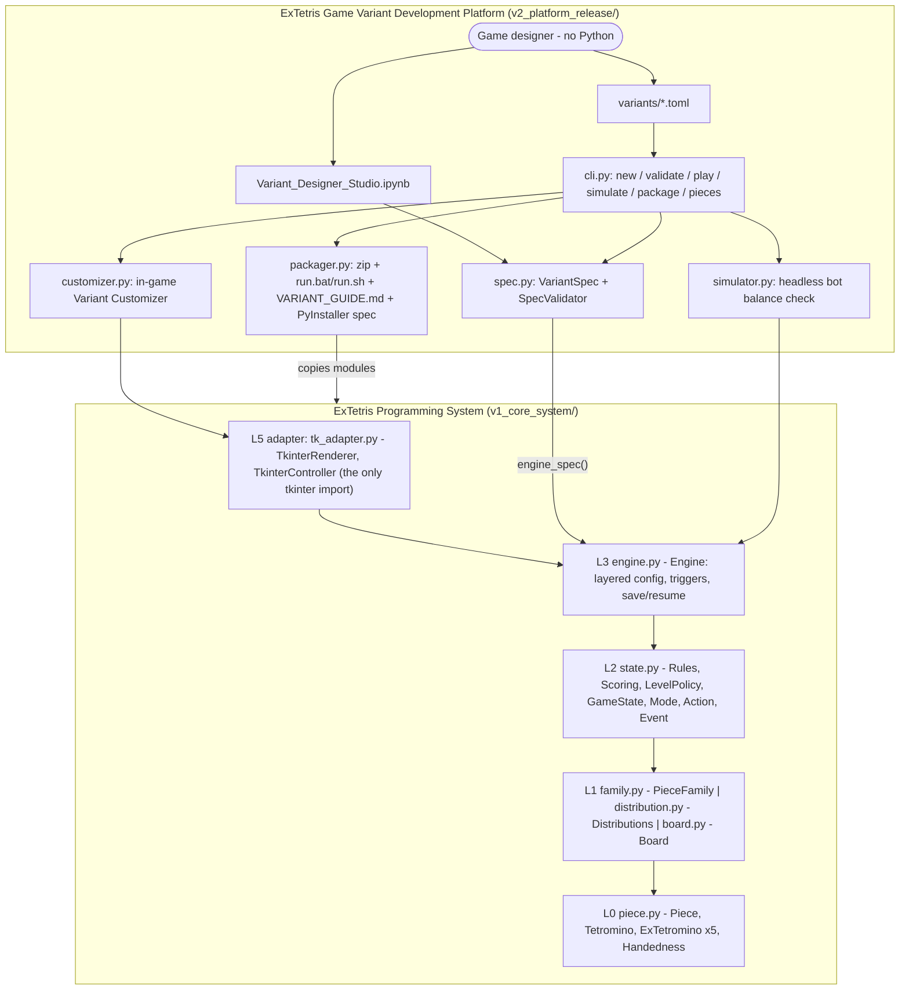
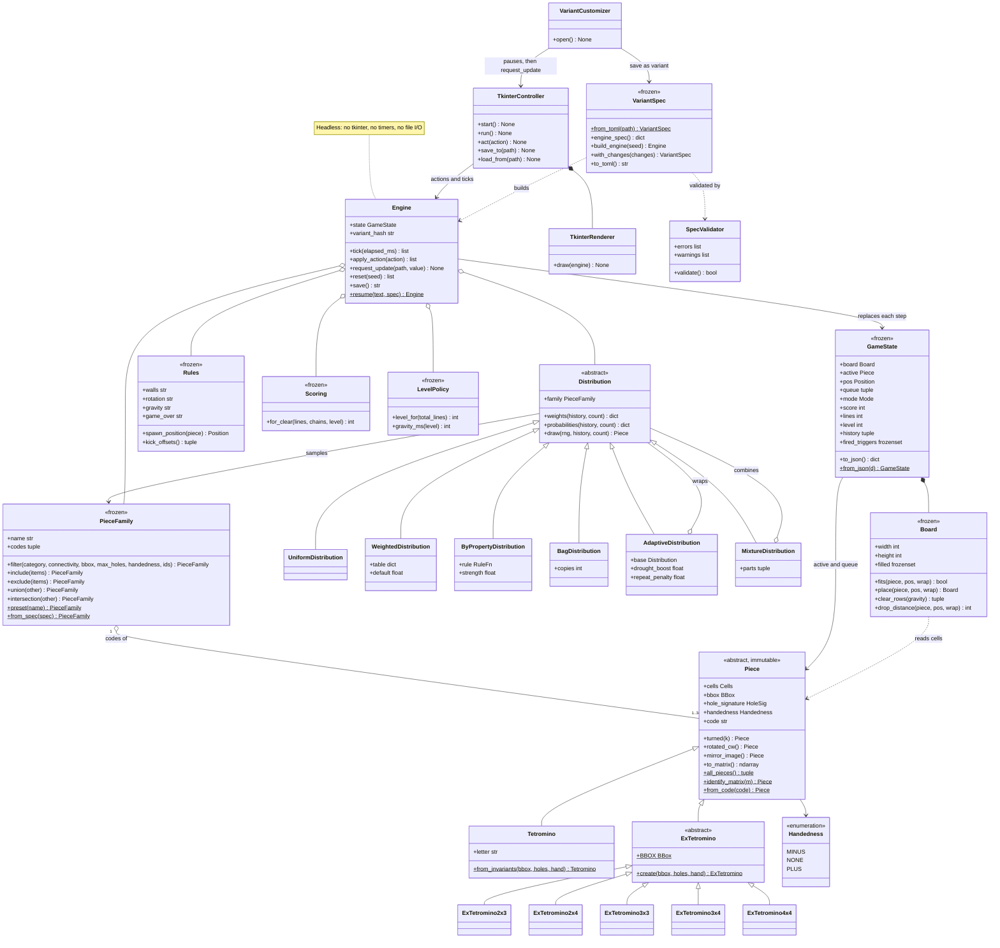
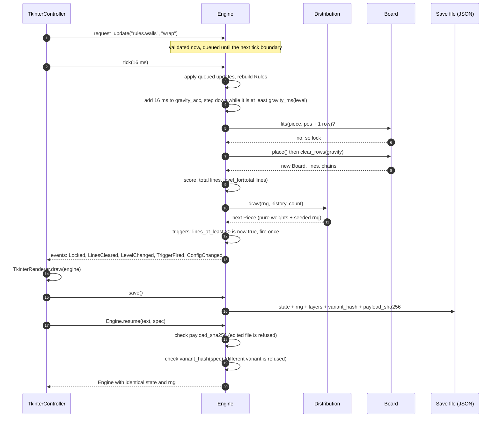
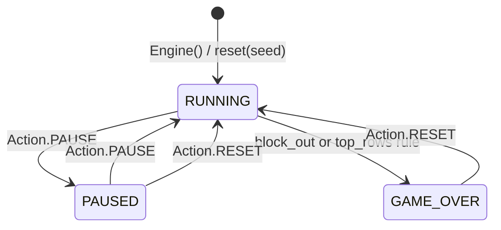
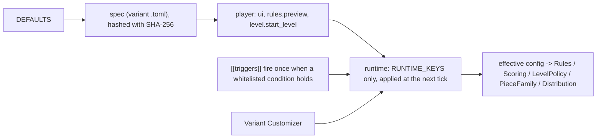

# ExTetris — Design Document (UML)

| | |
|---|---|
| **Course** | CS F301 Principles of Programming Languages, Sem-I 2026-27 |
| **Repository** | `extetris-popl-sahu` |
| **Covers** | `v1_core_system/` (ExTetris Programming System) and `v2_platform_release/` (ExTetris Game Variant Development Platform) |
| **Supersedes** | `docs/architecture_v1_blueprint.md` (rev 1.1), which was the plan. This document describes what was built. |
| **API reference** | `docs/api/index.html`, generated from the source docstrings with `pdoc` |
| **Verification** | `pytest v1_core_system v2_platform_release` → 48 passed (23 core + 25 platform). `verify_piece.py` → 9/9. `verify_v05.py` → proof complete. |

---

## 1. System vs Platform

The deliverable is a **platform** for non-programmers that contains a **programming system** (a Python library) as a strict subset. The library was built and verified first, so the API existed before any user interface.

**Dependency rule.** Arrows point only downwards. Two things enforce it:
- `test_engine_has_zero_tkinter` scans every core module's imports and imports `engine` with `tkinter` blocked.
- `test_package_is_self_contained` runs a shipped package with nothing but its own copy of the modules.

| Layer | Module | Responsibility | Lines |
|---|---|---|---|
| L0 | `piece.py` | 34 immutable pieces generated from geometry, with invariants | 759 |
| L1 | `family.py` | Immutable named piece sets, filters, set algebra, presets | 225 |
| L1 | `distribution.py` | Seeded functional-OO probability models | 246 |
| L1 | `board.py` | Immutable board, solid/wrap walls, naive/cascade clearing | 133 |
| L2 | `state.py` | Rules, Scoring, LevelPolicy, immutable GameState, events | 222 |
| L3 | `engine.py` | Headless state machine, layered config, triggers, save/resume | 442 |
| L5 | `tk_adapter.py` | Canvas renderer and single-clock controller | 229 |
| P | `spec.py` | TOML variant schema and plain-English validator | 488 |
| P | `cli.py`, `simulator.py`, `customizer.py`, `packager.py` | Platform commands | 621 |

---

## 2. Class hierarchy and composition (UML)

**Why the piece hierarchy looks like this.** Spec §3.2 asks for classification "by shapes, bounding boxes, holes produced while landing in different orientations".
- **Two branches:** `Tetromino` holds the 7 edge-connected pieces, and `ExTetromino` the 27 that need a corner contact.
- **Bounding-box subclasses:** `ExTetromino` splits into 5 subclasses by bounding box, holding 2, 9, 9, 6 and 1 pieces.
- **Constructor parameters:** each subclass takes a *landing-hole signature* and a *handedness*. Together with the bounding box, these identify all 34 pieces. `piece.py` checks this when it builds its catalogue, and `verify_piece.py` test 3 checks it again.
- **Why not diagonal count:** the earlier key `(bbox, diagonal count)` in `v0.5_failed_attempt/` was ambiguous. It maps 27 pieces onto 11 keys, and it can never separate the 10 mirror pairs, because reflection preserves both properties.

---

## 3. Dynamic behaviour: tick, trigger, save and resume

**What this design prevents:**
- `tick()` and the movement actions are ignored outside `RUNNING`, so pausing cannot create extra gravity loops (v0 BUG-03).
- There is exactly one clock: `TkinterController` keeps a single `after()` id, and `start()` cancels any existing one first.
- `GAME_OVER` is a mode, not `quit()`, so the board stays visible and New Game works (BUG-05).

---

## 4. Alignment with the paradigm (Bottom-Up, Modular, Imperative-OO)

| Paradigm element | Where it shows | Evidence |
|---|---|---|
| **Bottom-up** | Built and verified in layer order. Each layer had a passing check before the next started: L0 `piece.py` (Phase 2) → L1–L3 + L5 (Phase 3) → platform (Phase 4). | `verify_piece.py` 9/9 before `family.py`. `test_v1.py` 23/23 before `spec.py`. |
| **Cyclic top-down/bottom-up** | The blueprint (top-down) was revised by what implementation found (bottom-up). Rev 1.1 moved `Rules`/`Scoring`/`LevelPolicy` into `state.py` and replaced the planned `VariantSpec` in L4 with the engine's layered config plus the platform's `spec.py`. | `architecture_v1_blueprint.md` revision log |
| **Modular** | One responsibility per module, a downward-only import graph, and a single tkinter module. The platform copies the core modules unchanged into a package. | `test_engine_has_zero_tkinter`, `test_package_is_self_contained` |
| **Imperative core** | The engine is a state machine. `tick()`/`apply_action()` run imperative step loops (gravity accumulator, lock, clear, spawn) and *replace* `self.state`. | `engine.py` `_step_down`, `_lock`, `_spawn` |
| **Object-oriented** | Abstract classes with subclass polymorphism (`Piece`→`Tetromino`/`ExTetromino*`, `Distribution`→6 kinds). Composition (`Engine` *has* Rules, Scoring, LevelPolicy, PieceFamily, Distribution). Encapsulated invariants (`ShapeInfo`, read-only properties). | §2 diagram |
| **Functional elements** (where the spec asks for "functional-OO") | Immutable values (`Piece`, `Board`, `GameState`, `PieceFamily`, every distribution). Pure `weights(history)` functions. Distributions built from functions (`ByPropertyDistribution(rule=fn)`) and combinators (`mix`, `AdaptiveDistribution(base)`). | `test_distributions_are_deterministic_per_seed`, `test_determinism_same_seed_same_game` |
| **No code in data** | No `eval`/`exec` anywhere. TOML triggers use whitelisted conditions and targets. | `verify_piece.py` test 4, `test_triggers_fire_once_and_are_restricted`, `test_validator_plain_english` |

---

## 5. Configuration layers

**What each layer may change:**
- `rules.width` and `rules.height` can only be set in the spec. Player and runtime layers are rejected with `ConfigError`.
- The variant hash covers DEFAULTS + spec, so a save game is tied to the exact variant it was played with.

---

## 6. Known limitations

- The landing-hole definition used for classification has **not yet been confirmed** against the 6 Nov tutorial. If it differs, only `piece._landing_holes()` and the piece codes change, and uniqueness must be re-verified.
- Rotation is about the bounding-box top-left with simple column kicks, not SRS.
- The PyInstaller spec is generated but was not built in the sandbox. `build.bat` has not been run on Windows by the AI.
