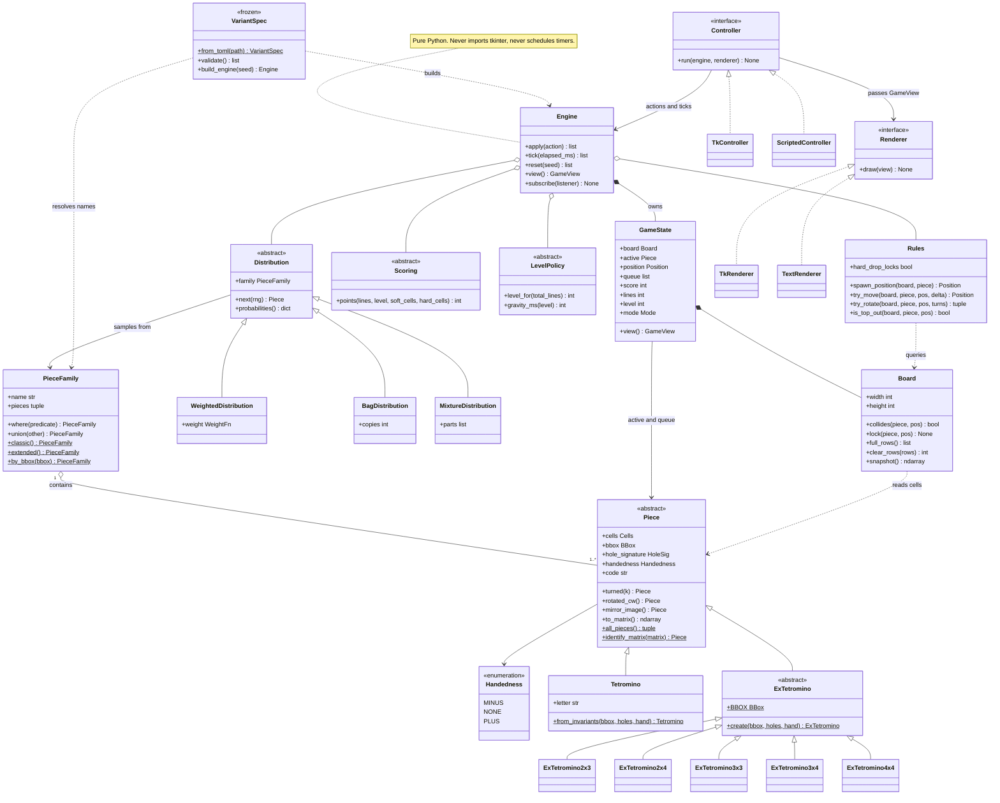
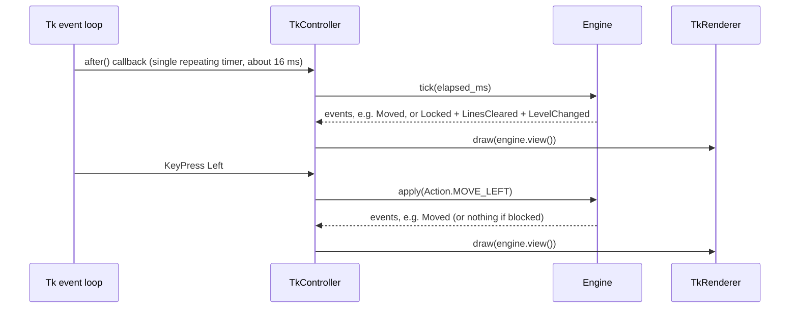
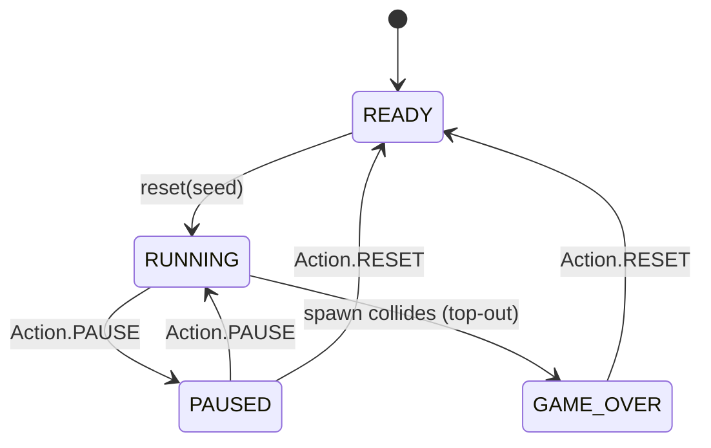

# ExTetris v1 — Architecture Blueprint (System + Platform)

| | |
|---|---|
| **Course** | CS F301 Principles of Programming Languages, Sem-I 2026-27 |
| **Document** | `docs/architecture_v1_blueprint.md` — revision 1.0, 2026-11-26 |
| **Inputs** | assignment spec §1.2, §2, §3 · `docs/v0_bug_audit.md` (23 starter bugs) · `scripts/explore_polyominoes.py` (110 fixed / 34 one-sided / 22 free pieces) · `v0.5_failed_attempt/` |
| **Status** | Layer 0 (`v1_core_system/piece.py`) implemented and verified. All other layers are specified here and not yet built. |
| **Paradigm** | Bottom-up, modular, imperative-OO; cyclic top-down (this blueprint) / bottom-up (one verified module at a time) |
| **Stack** | Python 3.11+, `numpy`, `tomllib`, `tkinter` (adapter only), `pytest`, `pdoc` |

---

## 1. Scope

The deliverable is an **ExTetris Game Variant Development Platform**. Inside it, as a strict subset, sits the **ExTetris Programming System**: a Python class library with a clean API.

```
+---------------------------------------------------------------------------+
|  ExTetris Game Variant Development Platform              (built second)   |
|   - variant files (TOML) written by game designers, no Python required    |
|   - CLI: new / validate / play / simulate / docs / package                |
|   - notebook template ("Colab-style" variant design)                      |
|   - Game Programmer's Manual, generated API docs                          |
|  +---------------------------------------------------------------------+  |
|  |  ExTetris Programming System  (v1_core_system/)      (built first)   |  |
|  |   pieces, families, distributions, board, rules, scoring, levels,    |  |
|  |   state, engine, variant specs, rendering/input adapters             |  |
|  +---------------------------------------------------------------------+  |
+---------------------------------------------------------------------------+
```

| Stakeholder | Works with | Needs |
|---|---|---|
| Game designer (non-programmer) | Platform: a `.toml` variant file and CLI commands | Change board size, piece set, piece probabilities, speed curve, scoring and controls without code; clear validation messages |
| Application programmer | System: Python API | Subclass or replace `Rules`, `Scoring`, `LevelPolicy`, `Distribution`; drive the `Engine` headless or with any UI |
| Player | A packaged variant | A correct game: no v0 bugs |

**Build order.** The Programming System comes first, so a usable API exists before the UI/CLI platform layer is finished.

---

## 2. Design principles

Each principle is traced to evidence from the v0 audit (`BUG-nn`, see §10).

| # | Principle | Motivated by |
|---|---|---|
| P1 | **The engine is pure.** `Engine` never imports `tkinter`, never schedules timers and does no I/O. It changes state only through `apply(action)` and `tick(elapsed_ms)`. | BUG-03, 05, 15, 16 |
| P2 | **Values are immutable.** `Piece`, `GameView`, `VariantSpec` and events are frozen. Rotating returns a new object. | BUG-02, 20 |
| P3 | **No code in data.** No `eval`/`exec`. Pieces come from invariants, and TOML refers only to *registered names*. | BUG-08, 09, 10 |
| P4 | **Explicit imports and explicit dependencies** (constructor injection). No `import *`. | BUG-13, 14 |
| P5 | **Determinism.** One seeded `random.Random` per game, owned by the engine and passed to `Distribution`, so games can be replayed and tested. | BUG-11 |
| P6 | **One owner per concern.** There is exactly one clock (the `Controller`) and one source of truth (`GameState` inside `Engine`). | BUG-03, 05 |
| P7 | **Layered, bottom-up modules.** A module may import only from lower layers. | maintainability, §3 |
| P8 | **Fail loudly at the designer boundary**, with messages that list the valid choices. | BUG-08, 10 |

---

## 3. Layers and module layout

```
 L5  Adapters        tk_adapter.py (TkRenderer, TkController)   text_adapter.py (TextRenderer, ScriptedController)
                        |  the ONLY module that imports tkinter      |  used by tests, notebooks, simulate
 ----------------------------------------------------------------------------------------------------------
 L4  Variant         variant.py      VariantSpec  (tomllib -> validated, frozen spec -> builds an Engine)
 ----------------------------------------------------------------------------------------------------------
 L3  State/Engine    state.py        GameState, GameView, Mode, Action, Event types
                     engine.py       Engine   (pure state machine; no tkinter, no clock)
 ----------------------------------------------------------------------------------------------------------
 L2  Policies        rules.py        Rules        scoring.py  Scoring      level.py  LevelPolicy
 ----------------------------------------------------------------------------------------------------------
 L1  Model           family.py       PieceFamily  distribution.py  Distribution    board.py  Board
 ----------------------------------------------------------------------------------------------------------
 L0  Geometry        piece.py        Piece, Tetromino, ExTetromino(2x3|2x4|3x3|3x4|4x4), Handedness   [DONE]
```
Dependencies point **downwards only**. A test enforces this (§11).

### 3.1 Repository layout

```
extetris-popl-sahu/
├── v0_starter/                    frozen starter baseline (never modified)
├── v0.5_failed_attempt/           preserved flawed constructor design (never deleted)
│   ├── piece_v05.py               classifies by (bounding box, diagonal count)
│   └── verify_v05.py              proof of the collisions
├── v1_core_system/                ExTetris Programming System
│   ├── piece.py          L0       [done]  immutable piece hierarchy
│   ├── verify_piece.py            [done]  9 checks, pytest-compatible
│   ├── family.py         L1       PieceFamily
│   ├── distribution.py   L1       Distribution (+ uniform / weighted / bag / mixture)
│   ├── board.py          L1       Board
│   ├── rules.py          L2       Rules (+ rotation kick tables)
│   ├── scoring.py        L2       Scoring, ClassicScoring
│   ├── level.py          L2       LevelPolicy, ThresholdLevelPolicy
│   ├── state.py          L3       GameState, GameView, Mode, Action, events
│   ├── engine.py         L3       Engine
│   ├── variant.py        L4       VariantSpec
│   ├── text_adapter.py   L5       TextRenderer, ScriptedController
│   ├── tk_adapter.py     L5       TkRenderer, TkController
│   └── tests/                     pytest: one file per module + v0 regression tests
├── v1_platform/          (later)  CLI, variant templates, notebook template, packaging
├── variants/                      designer-authored *.toml (classic.toml, corner_chaos.toml, ...)
├── scripts/explore_polyominoes.py
└── docs/
    ├── architecture_v1_blueprint.md   (this file)
    ├── v0_bug_audit.md · AI_Interaction_Log.md · screenshots/
    ├── api/                           (generated by pdoc)
    └── manual/                        Game Programmer's Manual
```

---

## 4. Responsibilities

Type aliases used below: `Cell = (row, col)`, `Cells = frozenset[Cell]`, `BBox = (short, long)`, `HoleSig = (h0, h1, h2, h3)`, `Position = (row, col)` of the piece's top-left anchor on the board.

| Class | Module | Responsibility (single reason to change) | Key API | Collaborators |
|---|---|---|---|---|
| `Piece` (abstract, immutable) | `piece` | Geometry of one piece in one orientation. Its invariants are bbox, landing-hole signature and handedness. | `cells`, `turned(k)`, `rotated_cw()`, `mirror_image()`, `to_matrix()`, `all_pieces()`, `identify_matrix()`, `from_code()` | `Handedness`, internal catalogue |
| `Tetromino` | `piece` | The 7 edge-connected classics. | `Tetromino("T")`, `from_invariants(bbox, holes, hand)` | — |
| `ExTetromino` (abstract) | `piece` | The 27 corner-connected pieces, dispatched by bounding box. | `ExTetromino.create(bbox, holes, hand)` | 5 subclasses |
| `ExTetromino2x3/2x4/3x3/3x4/4x4` | `piece` | Extended pieces of one bounding box (2/9/9/6/1 pieces), each built from `(holes, hand)`. | `ExTetromino3x3((2,2,3,3), Handedness.PLUS)` | — |
| `PieceFamily` | `family` | A named, immutable set of pieces, and set algebra over invariants. | `classic()`, `extended()`, `by_bbox("2x4")`, `where(pred)`, `\|`, `&`, `-` | `Piece` |
| `Distribution` (abstract) | `distribution` | The probability of the next piece. Functional-OO (§3.2 of the spec): built from a family plus a weight function. | `next(rng) -> Piece`, `probabilities()`, `uniform(f)`, `weighted(f, weight=fn)`, `bag(f)`, `mix(...)` | `PieceFamily`, `random.Random` |
| `Board` | `board` | The grid of locked cells. Explicit bounds checks; no negative-index wrap. | `collides(piece, pos)`, `lock(piece, pos)`, `full_rows()`, `clear_rows(rows) -> int`, `snapshot()` (read-only) | `Piece`, `numpy` |
| `Rules` | `rules` | Pure movement decisions: spawn position, move/rotate legality, kicks, lock and top-out. | `spawn_position()`, `try_move()`, `try_rotate()`, `is_top_out()`, `hard_drop_locks` | `Board`, `Piece` |
| `Scoring` (abstract) | `scoring` | Points for line clears and drops. | `points(lines, level, soft_cells, hard_cells) -> int` | — |
| `LevelPolicy` (abstract) | `level` | Level from total lines; gravity interval from level, clamped. | `level_for(total_lines)`, `gravity_ms(level)` | — |
| `GameState` | `state` | Mutable game data owned by the engine: board, active piece and position, queue, score, lines, level, mode, RNG. | `view() -> GameView` | `Board`, `Piece` |
| `Engine` | `engine` | The state machine. It applies actions and elapsed time to `GameState` using the injected policies, and returns events. | `apply(action)`, `tick(elapsed_ms)`, `reset(seed)`, `view()`, `subscribe(fn)` | everything in L0–L3 |
| `Renderer` (protocol) | adapters | Draws a `GameView`. Read-only; never touches the engine. | `draw(view)` | `GameView` |
| `Controller` (protocol) | adapters | Owns **the** clock and the input mapping. Turns input into `Action`s and time into `tick()` calls. | `run(engine, renderer)` | `Engine`, `Renderer` |
| `VariantSpec` (frozen) | `variant` | A designer's TOML file, validated, plus the factory that wires an `Engine`. | `from_toml(path)`, `validate() -> list[str]`, `build_engine(seed)` | `PieceFamily`, `Distribution`, policies, registries |

Supporting types (in `state.py`):
- `Mode` = `READY | RUNNING | PAUSED | GAME_OVER`
- `Action` = `MOVE_LEFT | MOVE_RIGHT | SOFT_DROP | HARD_DROP | ROTATE_CW | ROTATE_CCW | PAUSE | RESET`
- Frozen event dataclasses: `Spawned`, `Moved`, `Rotated`, `Locked`, `LinesCleared`, `ScoreChanged`, `LevelChanged`, `Paused`, `Resumed`, `GameOver`.
- `GameView`, a frozen snapshot of everything a renderer may show.

---

## 5. Class diagram (UML)

Rendered by GitHub / VS Code (Mermaid). An ASCII version follows for plain-text readers.



**Plain-text version**

```
Piece <<abstract, immutable>> --uses--> Handedness <<enum>>
 |-- Tetromino                       (7: I O T S Z L J)
 `-- ExTetromino <<abstract>>        (27, dispatched on BBOX)
      |-- ExTetromino2x3 (2)   |-- ExTetromino2x4 (9)   |-- ExTetromino3x3 (9)
      |-- ExTetromino3x4 (6)   `-- ExTetromino4x4 (1)

PieceFamily  o--- 1..*  Piece
Distribution <<abstract>> ---> PieceFamily        Distribution <|-- Weighted | Bag | Mixture

Engine *--- GameState *--- Board
Engine o--- Rules, Scoring <<abstract>>, LevelPolicy <<abstract>>, Distribution
GameState ---> Piece (active, queue)

VariantSpec <<frozen>> ..builds..> Engine ;  ..resolves..> PieceFamily
Controller <<interface>> ---> Engine (Action, tick)  ;  ---> Renderer <<interface>> (GameView)
TkController, ScriptedController ..implement..> Controller
TkRenderer, TextRenderer        ..implement..> Renderer
Engine has NO arrow to Renderer, Controller or tkinter.
```

---

## 6. Dynamic behaviour

### 6.1 One frame and one key press

The controller owns the single clock. The engine only reacts.



### 6.2 Game modes



- In `PAUSED` and `GAME_OVER`, `tick()` does nothing, and every action except `PAUSE`/`RESET` is ignored and produces no events. Extra gravity loops (BUG-03) therefore cannot occur, because there is only one loop and it lives in the controller.
- `GAME_OVER` is a state, not a `quit()`. The view stays on screen, and `RESET` starts a new game (BUG-05).
- Dialogs (About, Save) are adapter concerns: the controller sends `PAUSE` before opening one and restores the previous mode afterwards (BUG-04, BUG-16).

### 6.3 Gravity and levels (time model)

- `tick(elapsed_ms)` adds the elapsed time to an accumulator. While `accumulator >= level_policy.gravity_ms(level)`, the piece moves down one row; if it can't, it locks.
- Time comes from the controller (`time.monotonic()` differences). Tests pass synthetic times, so games are reproducible.
- `ThresholdLevelPolicy.level_for(lines) = 1 + lines // lines_per_level`. This is computed from the total, so a multi-line clear can never skip a level (BUG-06).
- `gravity_ms(level)` is clamped to `[min_gravity_ms, initial_gravity_ms]`, so 0 ms is impossible (BUG-07).

---

## 7. Decoupling `Engine` from `tkinter`

1. **Dependency rule.** Only `tk_adapter.py` may `import tkinter`.
2. **Interfaces.** `Renderer` and `Controller` are `typing.Protocol`s defined in `state.py`, which is L3 and has no UI imports. Adapters implement them.
3. **Data out, not calls out.** The engine returns frozen `Event`s and exposes a frozen `GameView`. It never calls a renderer. Optional `subscribe(listener)` callbacks receive the same event objects.
4. **Time in, not timers out.** The engine has no `after()`, `sleep()` or threads. `tick(elapsed_ms)` is the only way time reaches it.
5. **Enforced by tests.**
   - `tests/test_layers.py` imports `engine` in a subprocess with `sys.modules["tkinter"] = None`. Any tkinter import fails the test.
   - An AST scan checks that every `import` in `v1_core_system/` points to the same or a lower layer.
6. **Payoff.** The same engine runs under `TkController`, under `ScriptedController` in pytest, in a notebook through `TextRenderer`, and in `simulate` with no display at all.

---

## 8. Variant specification (Platform ↔ System contract)

A game designer writes a TOML file. `VariantSpec.from_toml()` parses it with `tomllib`, checks every key and value (unknown keys are errors, which catches typos), and returns a frozen spec. `build_engine(seed)` wires the components.

```toml
# variants/corner_chaos.toml
[variant]
name = "Corner Chaos"
version = "1.0"
authors = ["Team Sahu"]

[board]
width = 10
height = 20

[pieces]
families = ["classic", "extended:2x4", "extended:3x3"]
exclude = ["X3x3.H3333.0"]                # piece codes, as printed by verify_piece.py

[distribution]
kind = "weighted"                          # uniform | weighted | bag
weight_rule = "by_family"                  # uniform | by_family | favor_few_holes
seed = 2026                                # omit for a random game
[distribution.family_weights]
classic = 3.0
"extended:2x4" = 1.0
"extended:3x3" = 0.5

[speed]
initial_gravity_ms = 1000
min_gravity_ms = 60
gravity_factor = 0.9
lines_per_level = 10

[scoring]
kind = "classic"
line_points = [0, 100, 300, 500, 800]
soft_drop_per_cell = 1
hard_drop_per_cell = 2

[rules]
rotation_kicks = "none"                    # none | simple
hard_drop_locks = true

[controls]
move_left = "Left"
move_right = "Right"
rotate_cw = "Up"
rotate_ccw = "z"
soft_drop = "Down"
hard_drop = "space"
pause = "p"
```

**Extension without eval.**
- An application programmer registers a custom policy in Python, for example `@register_scoring("combo")`, and the TOML file selects it by name (`kind = "combo"`).
- TOML files never contain import paths, expressions or code. A designer can choose only from what is registered, and the error message lists the registered names.

---

## 9. Pieces and probabilities (spec §3.2)

**Hierarchy by geometry, not matrices** (implemented, see `v1_core_system/piece.py`).
- The two branches are `Tetromino` (edge-connected) and `ExTetromino` (needs a corner contact). `ExTetromino` subclasses are split by bounding box.
- Inside a class, a piece is selected by its **landing-hole signature** and **handedness**:
  - `(bbox, holes, hand)` identifies all 34 pieces. This is verified at catalogue build time and in `verify_piece.py`.
  - The v0.5 key `(bbox, diagonal count)` maps 27 extended pieces onto only 11 keys. It *cannot* separate the 10 mirror-image pairs, because reflection preserves both properties (`v0.5_failed_attempt/verify_v05.py`).

**Distribution as functional-OO.** The starter's "repeat an index to raise its probability" is replaced by an object built from a family and a pure weight function. Probability is per *piece* (34), not per stored matrix (73). This removes the starter's 1–4× listing bias.

```python
# planned API (iteration 2) -- PieceFamily and Distribution are not implemented yet
classic  = PieceFamily.classic()
corners  = PieceFamily.extended().where(lambda p: p.bbox in [(2, 4), (3, 3)])
gentle   = Distribution.weighted(classic | corners, weight=lambda p: 1 / (1 + p.min_landing_holes))
seven_bag = Distribution.bag(classic)                     # each classic once per 7 draws
mixed    = Distribution.mix((seven_bag, 0.8), (Distribution.uniform(corners), 0.2))
mixed.probabilities()                                     # {"I": 0.114..., "X2x4.H1133.+": 0.011..., ...}
```

---

## 10. Traceability: v0 bug → v1 design decision

| v0 bug (audit ID) | Decision | Component | Regression test |
|---|---|---|---|
| BUG-01 left wall wraps (negative index) | Explicit `0 <= r < h and 0 <= c < w` before indexing | `Board.collides` | port `[B1]`, `[G5]` |
| BUG-02 rotation mutates shared templates | Immutable `Piece`; rotation returns a new object | `piece` | `verify_piece` test 5 (done) |
| BUG-03 Down while paused spawns timers | Single clock in the controller; mode guard in the engine | `Engine`, `Controller` | port `[G1]`, `[G2]` |
| BUG-04 About leaves the game paused | Controller saves and restores mode around dialogs | `TkController` | new GUI test |
| BUG-05 game over broken | `GAME_OVER` mode; overlay drawn from `GameView`; `RESET` action | `Engine`, `TkRenderer` | port `[G6]` |
| BUG-06 speed-up skipped | Level computed from total lines | `LevelPolicy` | port `[E1]` |
| BUG-07 speed reaches 0 ms | Clamped gravity | `LevelPolicy` | port `[E2]` |
| BUG-08/09/10 `eval`, index 0, bad input | Registries and invariant constructors; validated `VariantSpec` | `piece`, `variant` | `verify_piece` test 4 (done) |
| BUG-11 distribution bias, unseeded RNG | Per-piece weights; seeded `random.Random` | `Distribution` | frequency test with a fixed seed |
| BUG-12/22 editable board, glyph width | Canvas renderer drawing rectangles (no `Text` widget, no emoji glyphs) | `TkRenderer` | GUI smoke test |
| BUG-13/14 implicit imports | Explicit imports only; layer test | all | `test_layers.py` |
| BUG-15 constructor runs `mainloop()` | Construction and running are separate: `Controller.run()` | `Engine`, `TkController` | import-and-construct test |
| BUG-16 "Save" saves screen text | Save/load a `GameState` snapshot (pieces pickle via codes) | `state`, platform | round-trip test |
| BUG-17–21, 23 minor | Fixed by construction (complete `Action` enum, no dead code) | — | lint + unit tests |

---

## 11. Build plan (bottom-up iterations)

Each iteration ends with a verification script or pytest module, an AI-log entry, and a revision of this blueprint if reality disagrees with it. That revision step is the top-down half of the cycle.

| It. | Deliverable | Exit criterion | Status |
|---|---|---|---|
| 1 | `piece.py` + `verify_piece.py` | 34 pieces, invariant-constructed, 73 starter matrices matched up to rotation, immutable | **done** |
| 2 | `family.py`, `distribution.py` | Seeded sampling matches `probabilities()` within tolerance | next |
| 3 | `board.py` | Bounds tests on all 4 walls; multi-row clear identical to v0's (correct) result | |
| 4 | `rules.py`, `scoring.py`, `level.py` | Unit tests incl. BUG-06/07 ports | |
| 5 | `state.py`, `engine.py`, `text_adapter.py` | Headless scripted games, deterministic per seed; BUG-03/05 ports pass | |
| 6 | `tk_adapter.py` | Playable classic variant; no `Text` widget; dialogs pause correctly | |
| 7 | `variant.py` + `variants/*.toml` | Every validation error names the offending TOML key | |
| 8 | Platform: CLI, templates, notebook, packaging | A designer can create, validate, play and package a variant without Python | |
| 9 | Docs: `pdoc` API, Game Programmer's Manual, UML refresh | Docs built from source; manual covers every TOML key | |

**Testing.**
- `pytest` per module, plus `tests/test_layers.py`.
- The v0 reproduction scripts are ported as regression tests: each must now report the bug as *absent*.
- `verify_*.py` scripts stay runnable without pytest, for the report.

---

## 12. Open decisions and risks

| Item | Current choice | To confirm |
|---|---|---|
| Landing-hole definition | Empty cells in the bbox with a piece cell above, on a flat floor | Against the 6 Nov tutorial video. If it changes, only `_landing_holes()` and the codes change, and uniqueness must be re-verified. |
| Handedness naming for designers | `PLUS`/`MINUS` (PLUS = hand of L and S), sign of Im Σz⁴ | Whether to show designers "left/right-handed" wording instead |
| Spawn orientation | Fewest landing holes, then flattest. This reproduces the Tetris Guideline spawn for all 7 classics. | Whether designers may override it per piece in TOML |
| Rotation system | Rotate about the bbox top-left, kicks `none` or `simple` | Whether to offer SRS-style kicks |
| Hard drop | Locks immediately (`hard_drop_locks = true`) | v0 let the piece slide afterwards |
| Packaging | Flat modules in `v1_core_system/` during iterations 1–7 | Move to an installable `extetris` package (`pyproject.toml`) for the platform |
| Piece size | `CELL_COUNT = 4`; uniqueness proven for 4 only | Pentomino variants would need a new uniqueness proof |

---

## Revision log

| Rev | Date | Change |
|---|---|---|
| 1.0 | 2026-11-26 | Initial blueprint; Layer 0 implemented (`piece.py`), v0.5 failure documented |
